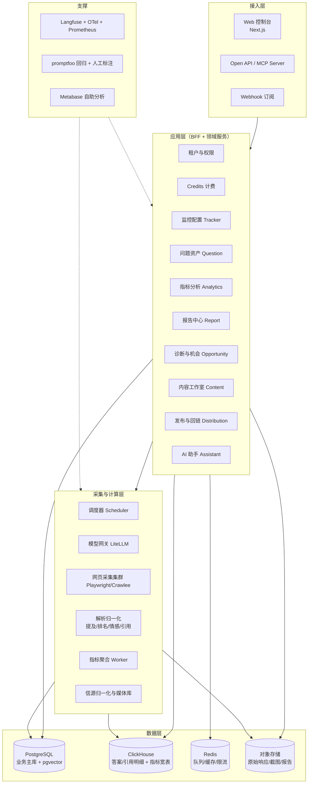
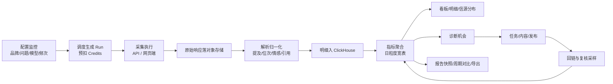

# GEO Insight 系统整体方案

**版本**：v0.2（首轮澄清后）
**日期**：2026-11-11
**变更**：2026-11-11 完成 5 项需求澄清（排名口径、采集范围、采样频次、首版边界、问题分层），见 §0.5 与 `docs/decisions/001-clarifications.md`
**依据**：8 张产品界面截图 + 本次需求描述
**定位**：面向品牌方与代理商的 GEO（Generative Engine Optimization，生成引擎优化）监测、诊断与优化闭环 SaaS。核心不是"查一下 AI 有没有提到我"，而是**用可复现的采样与可审计的口径，把 AI 答案里的品牌可见度变成可跟踪、可优化、可交付的指标**。

---

## 0. 从截图反推的产品现状与设计假设

### 0.1 截图里已经存在的功能

下表只写截图能证实的东西，括号内是界面证据。

| 域 | 已有能力 | 界面证据 |
|---|---|---|
| 工作台 | 首页概览、按品牌/产品切换视角 | 左侧导航「工作台 / 首页」，顶部品牌下拉 |
| 问题监控 | 监控对象列表（19 个）、监控中状态、核心词、AI 渠道数、监测问题数 | 监控列表：辽宁辽征律师事务所、惠禹（广州）、小鹏汽车、双源酒店等 |
| 问题监控 | 单对象详情：品牌、模型筛选（全部模型）、日期、问题数（40）、监控开关、创建人/时间 | 问题监控详情页头部 |
| 指标看板 | 提及数、提及率、平均排名、Top1/Top3/Top10、情感倾向（正/中/负） | 辽宁辽征案例：提及 25、提及率 0%、平均排名 —、中性 100% |
| 问答明细 | 按问题逐条查看答案、模型、日期、引用信源，支持"仅品牌/竞品/媒体引用"过滤 | 问答明细面板，引用信源「全部 54」 |
| 指标维度 | 指标看板、问答明细、指标明细、趋势分析、竞品分析、我品排名、信源分析、情感倾向、商机统计、商圈洞察、AI 分享、健康度 | 详情页 tab 栏 |
| 信源分析 | 行业信源分布：类型分布（新闻资讯 28.42%、其他站点 23.57%、视频媒体 18.40%…）、时间分布、媒体排行、内容明细 | 行业信源分布页：15,929 引用、1,237 媒体、4,878 内容、视频占比 8.6% |
| AI 简报 | 定期简报入口 | 左侧导航「AI 简报」 |
| 优化执行 | 优化机会、优化任务、内容工作室、任务发布 | 左侧「优化执行」分组四项 |
| 分析报告 | 报告中心、品牌资产、探索工具、行业信源分布 | 左侧「分析报告」分组 |
| 报告中心 | 优化周期与效果对比、监控分析/优化分析/品牌诊断三视角、发布文章引用、全部导出（40） | 报告中心页 |
| AI 助手 | 目标输入、分析问题选择、模型与设备（豆包网页）、日期范围、确认分析范围 | 右侧 AI 助手抽屉 |
| 数据范围 | 国内 AI 平台 / 客户工作台 | 左下角「数据范围」切换 |
| 计费 | Credits 余额 | 顶栏 9,318 / 9,618 Credits |

**关键产品信号**：截图里的"模型与设备"出现了「豆包网页」，说明系统同时支持 **API 通道**与**真实网页端采集**；「全部模型」说明是多模型横向对比；「优化周期」说明产品已经有**前后对比**的意识，这是 GEO 区别于 SEO 监控的核心价值点。

### 0.2 设计假设

| 编号 | 假设 | 若不成立的影响 |
|---|---|---|
| A1 | 目标客户是国内品牌方与营销代理商，国内 AI 平台为主、海外平台为辅 | 采集适配器与合规策略要重排优先级 |
| A2 | 多租户 SaaS，代理商可代管多个客户品牌 | 权限模型要从"用户-租户"升级为"用户-代理商-客户-品牌"四层 |
| A3 | 以"问题集"为监控核心，而不是关键词 | 指标体系、采样调度、报告结构全部围绕问题组织 |
| A4 | 按 Credits 计费，采集与生成都消耗额度 | 需要预扣+结算账本，且失败要可退 |
| A5 | 采样以日/周为周期，允许 T+1 出数 | 实时性要求低，可大量预聚合 |
| A6 | 网页端与 API 的回答会不一致，必须分通道记录 | 指标口径必须带"通道"维度，不能混算 |
| A7 | 答案非确定性，单次结果不可作为结论 | 必须多次采样并给置信区间 |
| A8 | 优化效果不是严格因果，只能做周期对比与对照问题集 | 报告措辞要避免"提升 X% 是因为我们" |

### 0.3 限制与风险

| 编号 | 限制 | 应对 |
|---|---|---|
| L1 | 各 AI 平台 ToS 对自动化访问的限制不一致 | 优先官方 API；网页端采集只做"客户授权 + 低频 + 合规评估"，并在合同里明确 |
| L2 | 登录态、验证码、风控会随时变化 | 采集适配器插件化 + 健康度监控 + 人工接管通道 |
| L3 | 模型版本静默升级，历史不可复现 | 每次采样记录模型标识、入口、时间、参数、截图/原始响应哈希 |
| L4 | 引用来源含大量"未知"（截图里 87.12%） | 先做域名/媒体归一化，再做时间抽取，未知单独成桶，不猜测 |
| L5 | 中文品牌别名、简称、错别字多 | 品牌词典 + 规则 + 向量召回三路合并，人工可纠正 |
| L6 | 情感与排名本质是主观判断 | 建立人工标注基准集，指标附"一致率"，不追求绝对真值 |
| L7 | 内容生成有合规与事实风险 | 事实卡约束 + 引用要求 + 人工审核 + 发布前检查 |
| L8 | 采集成本随模型数×问题数×频次线性上涨 | 问题分层（核心日采/长尾周采）+ 配额 + 缓存 |

### 0.4 明确的非目标（第一期不做）

- 不做通用 SEO 排名跟踪（Google/Baidu 自然位），只做 AI 答案可见度；传统搜索数据可作为对照输入。
- 不做全网舆情大屏，只围绕"监控问题集"取样。
- 不做自动大规模投放/刷量，发布侧只做合规渠道对接与人工确认。
- 不做"保证被 AI 引用"的承诺，只做可测量的概率提升。

---

### 0.5 已确认决策（2026-11-11）

| 编号 | 决策 | 影响 |
|---|---|---|
| C-01 | **平均排名 = 列表序号**：只统计答案推荐清单/编号列表中的位次；无列表结构的答案不计入平均排名，单独计「无列表样本」 | 解析器要识别有序列表；TopN 分母同步改为「有列表序号的样本」 |
| C-02 | **当前阶段只出方案，不做真实采集** | 不搭采集集群、不接登录态；架构保留双通道设计，实现前需补技术验证 |
| C-03 | **核心问题 3 次/日，长尾 1 次/日** | 核心有 3 样本可算置信区间；长尾只做趋势 |
| C-04 | **首版范围 = 监控 + 指标 + 报告** | 诊断、内容、发布顺延；首版验收只对采集、指标、报告负责 |
| C-05 | **核心/长尾由运营人工指定** | 问题资产需 `tier` 字段与批量标记，不做热度自动计算 |
| C-06 | **本地开发与演示不使用 Docker**，单进程 Python + SQLite 单文件跑通；页面由后端同源托管 | 本地不启 PG/CH/Redis；指标实时从明细聚合；规模化部署时才切回容器与列式存储 |

> 完整决策记录与遗留问题见 `docs/decisions/001-clarifications.md`、`docs/decisions/002-local-run-no-docker.md`。

---

## 1. 系统整体架构

### 1.1 架构原则

1. **采集与计算分离**：采集是最不稳定的一层，必须能独立降级、重试、替换，不能拖垮主站。
2. **原始数据不可变**：答案原文、引用列表、截图、请求参数一律落对象存储，结构化表只存解析结果，便于口径升级后重算。
3. **指标预聚合**：看板只查聚合表，明细走 ClickHouse，避免每次打开页面扫原始答案。
4. **口径即代码**：提及率、平均排名、TopN、情感、引用占比全部有版本号，历史数据可按口径版本重算。
5. **一切可追溯**：任何指标都能下钻到"哪次采样、哪个答案、哪段原文、哪个引用"。

### 1.2 分层架构

### 1.3 模块划分与职责

| 模块 | 核心职责 | 关键能力 | 明确不做 |
|---|---|---|---|
| 租户与权限 | 多租户隔离、RBAC、代理商代管 | 租户/客户/品牌三级、角色（ owner/运营/只读/客户）、SSO | 不做复杂 ABAC 表达式引擎 |
| Credits 计费 | 额度账本、预扣、结算、退款、套餐 | 双录账本、按采样/生成计费、超额拦截、账单导出 | 不做发票税务系统（对接外部） |
| 品牌资产 | 品牌、别名、竞品、行业、事实卡 | 别名词典、竞品集、品牌事实（成立时间/资质/服务范围）、禁说词 | 不做通用知识图谱 |
| 监控配置 | Tracker 生命周期、监控开关、高级设置 | 品牌×行业×地区组合、问题集绑定、采样计划、状态机 | 不做无限层级目录 |
| 问题资产 | 问题集、问题变体、意图分类、优先级 | 种子问题导入、LLM 扩写、去重聚类、意图/漏斗阶段标注、核心/长尾分层 | 不做关键词工具全量数据库 |
| 调度器 | 生成采样任务、配额控制、失败重试 | 定时/手动触发、按模型限速、优先级队列、幂等键 | 不做通用工作流平台 |
| 模型网关 | 统一多模型接入、成本统计、降级 | OpenAI 兼容适配、国内非标适配、超时/重试/熔断、token 与费用记账 | 不做模型微调 |
| 网页采集 | 真实 UI 答案采集 | 无头浏览器、会话管理、代理、验证码处理、截图存证 | 不绕过付费墙/不盗用他人账号 |
| 解析归一化 | 把答案变成结构化事实 | 答案分块、品牌提及检测、位次计算、情感分类、引用抽取、媒体归类 | 不做通用文档理解平台 |
| 指标分析 | 指标计算、趋势、竞品对比、信源分布 | 日粒度宽表、Wilson 置信区间、维度下钻、口径版本 | 不做任意 SQL 查询入口（客户侧） |
| 诊断与机会 | 从差距生成可执行建议 | 规则引擎（未提及/排名低/负面/信源缺失/竞品压制）+ LLM 归因、影响面排序 | 不承诺效果 |
| 内容工作室 | 选题→大纲→成稿→审核 | 品牌事实约束、引用要求、风格模板、合规检查、版本对比 | 不做自动批量洗稿 |
| 发布与回链 | 渠道发布、发布记录、回链监测 | 公众号/百家号/头条/知乎等渠道对接或 RPA、发布回执、URL 收录与引用复核 | 不做刷量 |
| 报告中心 | 周期对比、品牌诊断、导出 | 快照、基线选择、三视角报告、PDF/PPT 导出、订阅推送 | 不做通用 BI 设计器 |
| AI 助手 | 自然语言分析编排 | 范围确认、工具调用（指标/明细/信源）、结论引用、可追溯 | 不做无依据的开放问答 |
| 运营后台 | 采集健康度、成本、租户运营 | 成功率、封禁告警、模型变更、人工补采、审计日志 | — |

### 1.4 部署形态

- **SaaS 主形态**：单区域多租户，采集集群独立部署（可多出口 IP）。
- **私有化**：Docker Compose 单机版（PG + Redis + ClickHouse + 应用 + 采集），面向大客户；采集仍需外网出口。
- **混合**：客户内网只部署控制台与数据，采集走云端（数据脱敏后回传）。

---

## 2. 技术栈与选型理由

### 2.1 总表

| 层 | 选型 | 理由 | 备选 |
|---|---|---|---|
| Web 前端 | Next.js 15 + TypeScript + Tailwind + shadcn/ui | 管理台组件密度高，shadcn 可控样式；App Router 便于流式 AI 助手；生态与招聘成本平衡 | Vite + React、Vue3 + Naive UI |
| 图表 | ECharts | 环形图、漏斗、桑基、热力图覆盖全；中文文档好；截图里的环形+排行组合可直接实现 | Recharts、AntV G2 |
| 状态/请求 | TanStack Query + Zustand | 服务端状态与 UI 状态分离，缓存/重试/失效策略成熟 | SWR + Redux |
| API 服务 | FastAPI + Pydantic v2 + SQLAlchemy 2 + Alembic | LLM/爬虫/NLP 生态都在 Python；Pydantic 直接产出 OpenAPI 契约；异步 IO 适合大量外部调用 | NestJS、Go + Ent |
| 异步任务 | Celery + Redis（起步）→ Temporal（复杂后） | Celery 上手快、招人容易；采样与报告属可重试的短任务；长流程（内容审批/发布）再上 Temporal | Dramatiq、RQ、Arq |
| 采集 | Playwright + Crawlee | 真实 UI 采集必须有浏览器；Crawlee 提供队列、重试、代理、并发控制 | Selenium、Puppeteer |
| 网页解析 | Trafilatura / readability + 自研分块 | 正文抽取稳，中文适配可调；分块后才能做提及位次 | newspaper3k、go-readability |
| 模型接入 | LiteLLM（自建网关）+ 自研 Adapter | 统一 OpenAI/Anthropic/Gemini/国内模型接口，自带成本统计、fallback、限流；国内非标接口用 Adapter 补 | 自研全量网关、OpenRouter |
| 主库 | PostgreSQL 16 + pgvector | 事务与多租户成熟；pgvector 做问题去重、语义相似、品牌别名召回，省一个向量库 | MySQL + Milvus |
| 明细分析 | ClickHouse | 答案/引用是典型"宽表+高基数+聚合"场景，亿级下聚合仍快；物化视图支撑看板 | Doris、BigQuery |
| 缓存/队列 | Redis 7 | 缓存、限流、分布式锁、Celery broker 一物多用 | KeyDB、RabbitMQ |
| 对象存储 | S3 / 阿里云 OSS | 原始 HTML、截图、PDF 报告；生命周期策略降成本 | MinIO（私有化） |
| 评估 | promptfoo + Ragas + 人工标注集 | promptfoo 做模型升级回归；Ragas 评引用相关性；人工集是口径真值 | 自研评估平台 |
| 可观测 | Langfuse + OpenTelemetry + Prometheus/Grafana + Sentry | LLM 调用链、成本、延迟、错误分层可查；采集健康度单独看板 | Helicone、Datadog |
| 报表导出 | Gotenberg（HTML→PDF）+ Playwright 截图 | 报告用 HTML 模板排版，转 PDF 稳定；截图存证 | wkhtmltopdf、Puppeteer |
| BI（内部） | Metabase | 运营与客户成功自助查数，减少定制需求 | Superset |
| 部署 | Docker Compose → K8s；GitHub Actions | 早期不上 K8s，降低运维；规模化后按采集/计算/应用拆 | Nomad、ECS |
| 鉴权 | 自研 JWT + RBAC（起步）；Keycloak（企业版） | 早期简单可控；私有化客户常要求 LDAP/SSO | Auth0、Clerk |

### 2.2 三个关键取舍

**① 为什么后端是 Python，而不是 Node/Go**
GEO 的难点不在 CRUD，而在采集、解析、LLM 调用、中文 NLP、评估。这些生态 Python 最厚。FastAPI 的异步能力足以扛住 API 层；真正的重活都在 Worker 里。代价是 CPU 密集型任务要单独拆进程，不能写在请求链路里。

**② 为什么 PG + ClickHouse 双库，而不是单库**
业务表（租户、监控、任务、账单）要事务与约束，PG 合适。答案与引用是"每次采样 × 每个模型 × 每个问题"的明细，量和聚合方式都更像日志，ClickHouse 合适。用 PG 硬扛会导致看板越用越慢；用 ClickHouse 做业务库会失去事务与更新能力。两库通过 run_id / answer_id 关联，不做跨库事务。

**③ 为什么必须同时有 API 与网页端两条采集通道**
API 回答通常不带联网检索与引用，网页端才是用户真正看到的东西。截图里出现「豆包网页」正是这个原因。但网页端成本高、易碎、有合规风险，所以策略是：**能 API 的用 API 做广度，核心问题用网页端做真实性校验**，两条通道分开存储、分开统计、在 UI 上明确标注。

### 2.3 不建议的选择

- 一开始就上微服务 + K8s：模块边界还没稳定，运维成本会吃掉迭代速度。
- 自建向量数据库：pgvector 在百万级问题/别名的场景足够，先别加组件。
- 用单一 LLM 做"提及检测 + 情感 + 排名"三件事：成本高且不稳定，规则 + 小模型 + LLM 兜底更划算。
- 直接爬取客户个人账号：合规风险高，优先官方 API 与客户授权企业账号。

---

## 3. 关键数据流与接口设计

### 3.1 主链路总览

### 3.2 链路 A：监控采样（最核心）

1. 用户配置 Tracker：品牌 + 别名 + 竞品 + 行业 + 地区 + 问题集 + 模型/端 + 频次。
2. 调度器按 `sampling_plan` 生成 `run`（一次批量）与 `run_item`（问题×模型×端×样本序号）。
3. 执行前按单价预扣 Credits，写 `credit_ledger`（预扣）。
4. Worker 取任务：
   - API 通道：LiteLLM 统一调用，记录 model、version、temperature、token、cost。
   - 网页端：Playwright 打开目标平台，使用客户授权会话，提交问题，等待完整回答，保存 HTML + 截图 + 引用列表。
5. 原始响应写对象存储，路径 `s3://geo-raw/{tenant}/{date}/{run_item_id}.json|.png`。
6. 解析器产出 `answer`（全文、分块）、`mention`（品牌、位置、句序号、情感）、`citation`（URL、域名、媒体、位置、类型）。
7. 成功则结算 Credits，失败按规则退款并记录失败原因（超时/风控/验证码/模型拒答）。
8. 触发 `answer.normalized` 事件，进入聚合。

**幂等**：`run_item` 唯一键 `(run_id, question_id, model_id, channel, sample_idx)`；重复执行返回已有结果。

**采样策略（已确认）**：核心问题每日 3 次、长尾每日 1 次；核心/长尾由运营在问题集里人工指定。同一问题同一模型至少 3 次才能给出置信区间；长尾单样本只做趋势参考，不出 TopN 结论。样本量不足时 UI 显示"样本不足"，不显示 0%。

### 3.3 链路 B：指标聚合

- 触发：定时（每小时增量）+ 事件驱动（run 完成后）。
- 计算：按 `tenant × tracker × question × model × channel × day` 聚合，写入 ClickHouse `metric_daily`。
- 口径版本：`metric_version` 字段，口径升级后可重算历史。
- 置信区间：提及率给 Wilson 95% 区间，避免 3 次采样得到 0% 或 100% 就下结论。

### 3.4 链路 C：诊断 → 任务 → 内容 → 发布 → 复核

1. 诊断规则（示例）：
   - 未提及：核心问题下本品牌 0 次出现，且竞品出现 ≥ 2 次 → 高优先级。
   - 排名低：平均位次 > 5，且 Top3 被竞品占据。
   - 负面：负面情感占比 > 20%。
   - 信源缺失：答案引用的媒体里没有品牌自有/权威信源。
   - 内容缺口：某类问题下行业信源集中在某几个媒体，而品牌未布局。
2. LLM 归因：把"问题 + 答案 + 引用 + 竞品"作为上下文，产出"差距解释 + 建议动作 + 预期影响面"，必须引用证据（answer_id / citation_id）。
3. 生成 `opportunity`，按影响面（问题搜索量代理值 × 当前差距 × 可执行性）排序。
4. 一键转 `task`，进入内容工作室；内容生成受品牌事实卡约束，必须带引用建议与禁说词检查。
5. 发布后记录 `publication`，定期复核该 URL 是否被 AI 答案引用，形成回链闭环。

### 3.5 链路 D：报告中心

- 报告 = 快照，不是实时查询。生成时把指标、图表数据、结论写入 `report_snapshot`，保证 30 天后打开仍是当时口径。
- 周期对比必须选基线：同问题集、同模型、同通道，且样本量达标；不满足时报告标注"不可比"。
- 三视角对应截图：监控分析（现状/增速）、优化分析（验证增长）、品牌诊断（发现变化）。
- 导出：HTML 模板 → Gotenberg → PDF；需要 PPT 时用模板化 pptx 生成，不截图拼页。

### 3.6 核心数据模型

| 表 | 关键字段 | 说明 |
|---|---|---|
| tenant | id, name, plan, status | 租户 |
| user / role | id, tenant_id, email, role | 用户与角色 |
| credit_ledger | id, tenant_id, type(预扣/结算/退款/充值), amount, ref_id | 双录账本，余额=汇总 |
| brand | id, tenant_id, name, industry, region | 品牌 |
| brand_alias | brand_id, alias, type(简称/错写/英文) | 别名词典 |
| competitor | id, tracker_id, brand_id/name | 竞品集 |
| question | id, tenant_id, text, intent, funnel_stage, priority, embedding | 问题资产 |
| question_set | id, tracker_id, name | 问题集 |
| tracker | id, tenant_id, brand_id, industry, status, settings_json | 监控对象 |
| sampling_plan | id, tracker_id, cron, models_json, channel, sample_count | 采样计划 |
| run | id, tracker_id, trigger, status, credit_hold_id | 一次批量 |
| run_item | id, run_id, question_id, model_id, channel, sample_idx, status, error_code | 最小执行单元 |
| answer | id, run_item_id, raw_uri, text, model_version, latency_ms, tokens, cost | 答案 |
| answer_block | answer_id, seq, text, block_type | 分块，用于位次计算 |
| mention | answer_id, brand_id, first_seq, position, sentiment, snippet | 提及 |
| citation | answer_id, url, domain, media_id, position, cite_type(正文/参考/视频) | 引用 |
| metric_daily | tenant, tracker, question, model, channel, date, metrics_json, metric_version | 聚合宽表 |
| opportunity | id, tracker_id, type, evidence_json, impact_score, status | 机会 |
| task | id, opportunity_id, owner, status, due_at | 任务 |
| content | id, task_id, title, body, status, fact_check_json | 内容 |
| publication | id, content_id, channel, url, published_at, recheck_status | 发布与回链 |
| report | id, tenant_id, tracker_id, period, status | 报告 |
| report_snapshot | report_id, payload_json, generated_at | 不可变快照 |
| model_endpoint | id, provider, model_name, channel, version, price_json, status | 模型与价格 |
| source_media | id, domain, name, type(新闻/视频/百科/电商…), authority_score | 媒体库 |

### 3.7 API 设计

统一前缀 `/v1`，JSON，Bearer Token，租户从 token 解析；写操作支持 `Idempotency-Key`。

| 方法 | 路径 | 用途 |
|---|---|---|
| POST | `/v1/trackers` | 创建监控对象 |
| GET | `/v1/trackers` | 监控列表（含状态、问题数、渠道数） |
| PATCH | `/v1/trackers/{id}` | 开关监控、改设置 |
| POST | `/v1/trackers/{id}/questions` | 批量导入/生成问题 |
| GET | `/v1/questions` | 问题资产查询 |
| POST | `/v1/runs` | 手动触发采样（异步） |
| GET | `/v1/runs/{id}` | 进度与失败明细 |
| GET | `/v1/metrics/overview` | 指标卡（提及数/率/排名/TopN/情感） |
| GET | `/v1/metrics/trend` | 趋势序列 |
| GET | `/v1/answers` | 问答明细（问题/模型/日期/引用过滤） |
| GET | `/v1/citations/summary` | 信源类型/时间/媒体分布 |
| GET | `/v1/citations/contents` | 内容明细列表 |
| POST | `/v1/opportunities:generate` | 生成诊断机会 |
| GET | `/v1/opportunities` | 机会列表与影响面排序 |
| POST | `/v1/tasks` | 机会转任务 |
| POST | `/v1/contents:generate` | 内容草稿生成 |
| POST | `/v1/publications` | 登记发布与回链 |
| POST | `/v1/reports` | 生成报告快照 |
| GET | `/v1/reports/{id}/export?format=pdf` | 导出 |
| POST | `/v1/assistant/sessions` | 创建 AI 助手会话 |
| POST | `/v1/assistant/sessions/{id}/scope` | 确认分析范围（截图里的"确认分析范围"） |
| GET | `/v1/assistant/sessions/{id}/events` | SSE 流式输出 |

**事件（内部）**：`run.requested`、`run_item.completed`、`answer.normalized`、`metrics.recomputed`、`opportunity.created`、`task.status_changed`、`report.ready`。事件带 `tenant_id`、`trace_id`，消费端幂等。

**错误约定**：`{code, message, request_id, details}`；采集类错误单独 `error_code`（`RATE_LIMITED`、`CAPTCHA`、`LOGIN_REQUIRED`、`MODEL_REFUSED`、`TIMEOUT`），前端据此展示不同文案与"重试/补采"入口。

### 3.8 指标口径（必须先在需求里定死）

| 指标 | 建议定义 | 分母/边界 |
|---|---|---|
| 提及数 | 有效样本中提到品牌的次数 | 一个答案多次出现算 1 次（可另设"出现次数"） |
| 提及率 | 提及样本数 / 有效样本数 | 按问题×模型×通道×时间窗；样本不足标注 |
| 覆盖率 | 有提及的问题数 / 监控问题总数 | 按问题去重，不乘模型 |
| 平均排名 | 仅提及样本内，品牌在答案**推荐清单/编号列表**中的序号均值（C-01 已确认） | 无列表结构的答案不计入平均排名，单独计「无列表样本」；TopN 同口径 |
| Top1/Top3/Top10 | 位次 ≤ N 的样本 / 有效样本 | 与平均排名同口径 |
| 情感倾向 | 提及片段的情感分类（正/中/负） | 多品牌混合答案按"品牌-片段"归属 |
| 引用占比 | 某媒体引用次数 / 总引用次数 | 同 URL 多次出现算多次；需注明是否去重 |
| 视频引用占比 | 视频类引用 / 总引用 | 依赖媒体类型库 |
| Share of Voice | 本品牌提及数 / 所有跟踪品牌提及数 | 竞品集变化会影响历史，需固定版本 |

> 建议把这张表作为 `metric_version v1` 写入产品文档，并在 UI 上提供"口径说明"入口。这是客户质疑最多的地方。

---

## 4. 可参考的开源项目

> 说明：下列仓库均来自 2026 年 10 月的公开盘点与项目 README 线索，星数与活跃度会变，接入前请自行核对 LICENSE、最近提交与支持的引擎。**不要把盘点文章里的评分当作事实。**

### 4.1 GEO / AEO 垂直项目

| 仓库 | 定位 | 对本项目的用法 | 许可证提示 |
|---|---|---|---|
| `elmohq/elmo` | 自托管 AI 可见度平台，多引擎、Dashboard + REST + MCP，Postgres | **首选参考架构**：数据模型、指标页、Query Fan-Out 思路可直接借鉴；可先部署做竞品对标 | MIT |
| `ansvisor/ansvisor` | 端到端 AI 搜索情报：Prompt/Citation/竞品/站点审计 | 参考其"Analytics → Opportunities → Actions → Validation"闭环设计 | MIT |
| `danishashko/geo-aeo-tracker` | 轻量自托管，0-100 可见度分，多引擎 | 适合快速验证采集与评分逻辑，代码量小 | MIT |
| `oneglanse/oneglanse` | 通过真实浏览器 UI 采集，ClickHouse 存储 | **网页端采集**的工程参考，尤其是会话与存储设计 | MIT（注意 ToS 风险） |
| `Auriti-Labs/geo-optimizer-skill` | 站点 GEO 就绪度审计（CLI/Python/MCP） | 做"品牌官网 AI 可读性"诊断模块，或作为机会来源 | MIT |
| `cxcscmu/AutoGEO` | ICLR'26 研究框架，学习生成引擎偏好并改写内容 | 内容工作室的改写策略参考，不建议直接生产化 | 研究代码，需核对 |
| `jianruntech/geo-score` | 0-100 GEO 评分 + 引用追踪，零依赖 | 评分卡与 MCP Server 的轻量参考 | 需核对 |
| `usenotra/notra` | 监测 + 内容缺口转草稿 + AI 流量 SDK | 参考"缺口→内容"链路 | **AGPL-3.0**，商用需法务评估 |
| `dgtlmoon/changedetection.io` | 网页变化监控 | 监控竞品/自有内容页是否被引用、答案是否变化 | Apache-2.0 |
| `UnderleveledBuilder/awesome-seo-geo-skills` | GEO/SEO 技能与仓库索引 | 持续跟踪生态，不必自己维护清单 | 索引类 |

### 4.2 基础设施与组件

| 仓库 | 用途 | 建议 |
|---|---|---|
| `BerriAI/litellm` | 100+ LLM 统一网关、成本统计、fallback | **直接引入**，省掉多模型适配的一半工作 |
| `promptfoo/promptfoo` | Prompt/模型回归测试、断言、红队 | 模型升级前跑回归，防止指标漂移 |
| `langfuse/langfuse` | LLM 调用链、成本、评估 | 自托管，接 OTel |
| `apify/crawlee` | 爬虫队列、重试、代理、并发 | 网页采集框架 |
| `microsoft/playwright` | 浏览器自动化 | 采集与报告截图 |
| `unclecode/crawl4ai` | LLM 友好网页抓取 | 竞品/信源页正文抽取 |
| `adbar/trafilatura` | 正文抽取 | 轻量、稳定，先于 LLM 使用 |
| `ClickHouse/ClickHouse` | 明细与聚合 | 答案/引用/指标宽表 |
| `pgvector/pgvector` | 向量检索 | 问题去重、别名召回 |
| `celery/celery` | 任务队列 | 起步够用 |
| `temporalio/temporal` | 长流程编排 | 内容审批/发布链路复杂后再上 |
| `metabase/metabase` | 自助 BI | 内部运营先用 |
| `gotenberg/gotenberg` | HTML→PDF | 报告导出 |
| `n8n-io/n8n` | 发布/通知编排 | 早期替代自研渠道对接 |
| `hankcs/HanLP` | 中文分词/NER | 品牌与实体识别 |
| `FlagOpen/FlagEmbedding` | BGE-M3 等中文 embedding | 语义去重与聚类 |
| `explodinggradients/ragas` | RAG/引用质量评估 | 评"引用是否支撑结论" |
| `posthog/posthog` | 产品分析 | 可选，看留存与功能使用 |

### 4.3 选型建议

- **直接部署**：LiteLLM、Langfuse、ClickHouse、PG/pgvector、Crawlee/Playwright、Gotenberg、Metabase。
- **只借鉴不套壳**：elmo、ansvisor、oneglanse。它们的价值是"少走弯路"，不是"直接换皮"；数据模型和权限模型大概率不满足你的多租户与 Credits 需求。
- **许可证红线**：`notra` 是 AGPL-3.0，若做 SaaS 且修改后提供网络服务，可能触发开源义务；`oneglanse` 的 UI 采集方式要单独做合规评估。MIT/Apache-2.0 也要保留版权声明。

---

## 5. 分阶段实施建议

### 5.1 阶段规划

| 阶段 | 周期 | 目标 | 范围 | 验收标准 |
|---|---|---|---|---|
| Phase 0 口径与可行性验证 | 1-2 周 | 证明"算得准、成本可控"，**不建采集系统** | 2 个行业 × 10 个问题 × 2 个模型，人工采样各 3 次；人工标注 10 份基准；产出《指标口径 v0.1》 | 提及/情感与人工一致率 ≥ 85%；单样本成本可估算；口径无歧义 |
| Phase 1 MVP | 4 周 | 能看的监控台 | 单租户（或轻多租户）、Tracker、问题集、日采样、指标卡、问答明细、信源分布、PDF 报告 | 看板 P95 < 2s；报告生成 < 60s；核心问题覆盖 2 个模型；可导出 |
| Phase 2 SaaS 化 | 4-6 周 | 能卖的版本 | 多租户 + RBAC、Credits 账本、模型扩容到 5+、调度与配额、竞品 Share of Voice、品牌资产、AI 简报 | 租户隔离测试通过；超额拦截有效；账单可对账；采集成功率 ≥ 95% |
| Phase 3 优化闭环 | 6-8 周 | 从"看见"到"能改" | 诊断机会、内容工作室、任务、发布与回链、周期对比报告 | 机会有证据链；内容事实校验通过率 ≥ 95%；回链复核可跑通；报告可标注"不可比" |
| Phase 4 智能化 | 持续 | 差异化 | AI 助手 Agent、Open API/MCP、行业信源库、归因分析、私有化 | 助手结论 100% 可下钻；API 覆盖核心能力；私有化可交付 |

### 5.2 Phase 0 必须先验证的 5 件事

1. **网页端是否值得采**（当前不实施，只做评估）：豆包/元宝/Kimi 等的登录态、验证码、回答完成判定、引用区域 DOM 稳定性，以及平台 ToS 是否允许。
2. **API 与网页端差多少**：同一问题同一模型，API 回答是否带检索与引用；差异要用数据说话。
3. **提及检测准不准**：中文别名、简称、错写、否定句（"XX 不如 YY"）会不会误判。
4. **列表序号识别得准不准**：同一批答案由人工标序号，与解析器结果对比；无列表结构的答案要能正确归入「无列表样本」。
5. **成本模型**：单问题单模型单次采样的 API/代理/算力成本，决定 Credits 定价。

> Phase 0 的产出不是代码，而是一份《GEO 指标口径 v0.1》+ 一份人工标注基准集。没有这两样，后面所有看板都不可信。

### 5.3 团队与成本（粗估）

- 人力：后端 2、前端 1、数据/算法 1、QA 0.5、产品/设计 0.5。Phase 0 可只投入 1 后端 + 1 算法。
- 固定成本：服务器（PG/CH/Redis/应用/采集）约 3-5 台 8C16G；对象存储按量。
- 变动成本：模型 API token、代理 IP、验证码服务、内容生成。**Credits 定价必须覆盖 P95 变动成本 + 30% 毛利**。
- 时间风险：网页端采集适配是最大不确定项，建议预留 30% buffer，并准备"只做 API 通道"的降级版本。

### 5.4 里程碑建议

- M1（第 2 周末）：技术验证报告 + 口径 v0.1 + 可演示的 10 个问题看板。
- M2（第 6 周末）：MVP 内测，2 个真实客户品牌。
- M3（第 12 周末）：SaaS 计费上线，支持 10 个租户。
- M4（第 20 周末）：优化闭环可用，报告可对外交付。

---

## 6. 待确认的关键问题（Top 10）

1. 提及率的分母到底是"问题数"还是"问题×模型×采样次数"？两者会差一个数量级。
2. "平均排名"的位次定义是什么？推荐列表、段落顺序、还是首次出现位置？
3. 网页端采集是否获得平台授权？没有授权时，产品是否接受"仅 API"？
4. 每个问题每模型每天采几次？次数直接决定成本与置信度。
5. 竞品是人工维护还是自动发现？竞品集变更后历史指标是否重算？
6. Credits 的计价单位是什么（按问题/按模型/按次/按 token）？失败是否退？
7. 代理商模式下，客户能否看到原始答案与截图？数据隔离边界在哪？
8. 报告里的"优化效果"允许做到什么程度的归因？是否需要对照组？
9. 是否需要海外模型与多地区？这会影响代理与合规方案。
10. 私有化是否是硬需求？决定是否从第一天就做多租户+可离线部署。

> 更完整的需求质量清单见 `docs/checklists/geo-requirements.md`（35 条，按 completeness/clarity/consistency/measurability/coverage 分类）。

---

## 附录 A：术语

- **GEO**：Generative Engine Optimization，让品牌在生成式 AI 答案中被提及、被推荐、被引用。
- **AEO**：Answer Engine Optimization，更偏问答/摘要场景，常与 GEO 混用。
- **Query Fan-out**：AI 在回答前自动拆解并执行的子查询，决定它去哪些信源找答案。
- **Share of Voice**：在跟踪品牌集合中，本品牌提及数占比。
- **有效样本**：采集成功、答案非空、非拒答、通过质量校验的样本；失败样本不进分母。

## 附录 B：参考入口

- Elmo：`github.com/elmohq/elmo`
- Ansvisor：`github.com/ansvisor/ansvisor`
- GEO/AEO Tracker：`github.com/danishashko/geo-aeo-tracker`
- OneGlanse：`github.com/oneglanse/oneglanse`
- GEO Optimizer Skill：`github.com/Auriti-Labs/geo-optimizer-skill`
- AutoGEO：`github.com/cxcscmu/AutoGEO`
- LiteLLM：`github.com/BerriAI/litellm`
- promptfoo：`github.com/promptfoo/promptfoo`
- Langfuse：`github.com/langfuse/langfuse`
- Crawlee：`github.com/apify/crawlee`
- Crawl4AI：`github.com/unclecode/crawl4ai`

> 以上链接为公开仓库线索，接入前请以仓库 README 与实际 LICENSE 为准。
