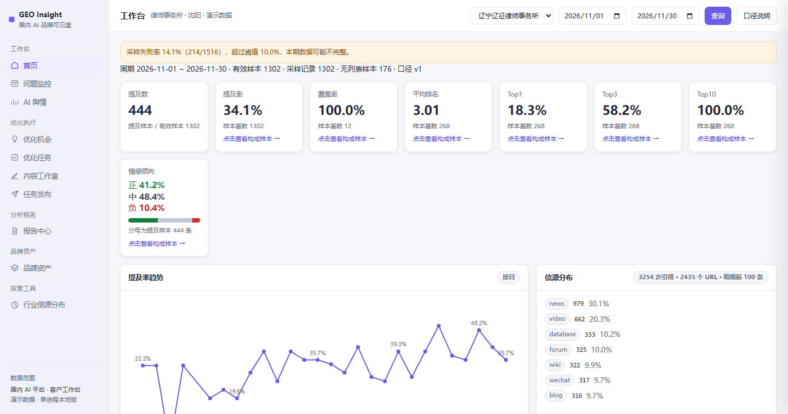
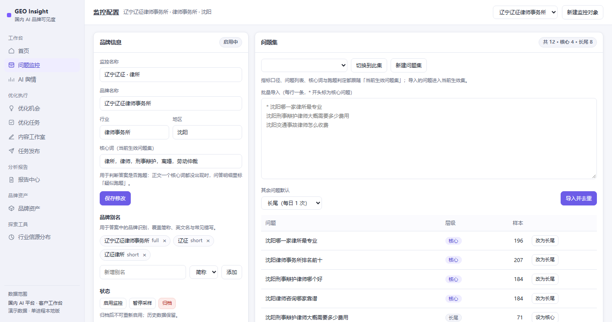
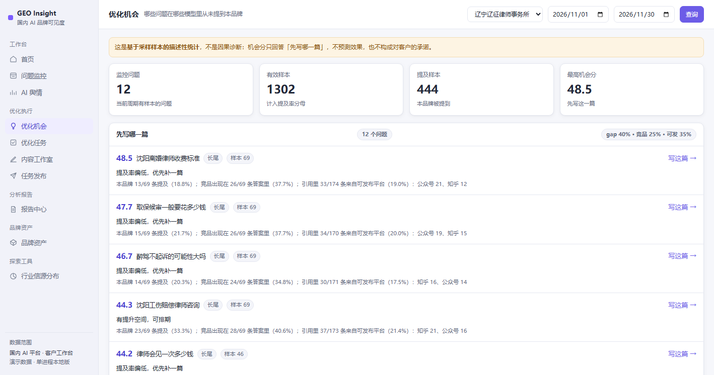
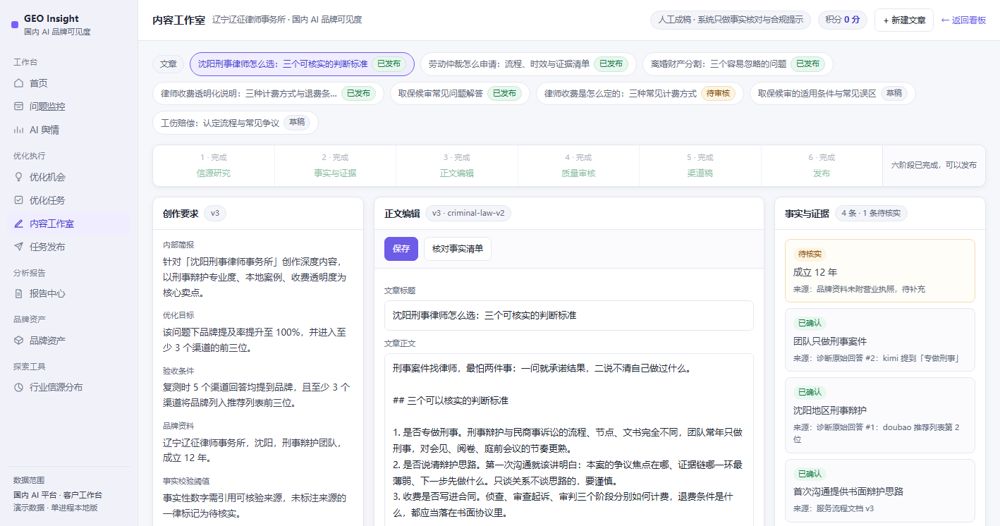
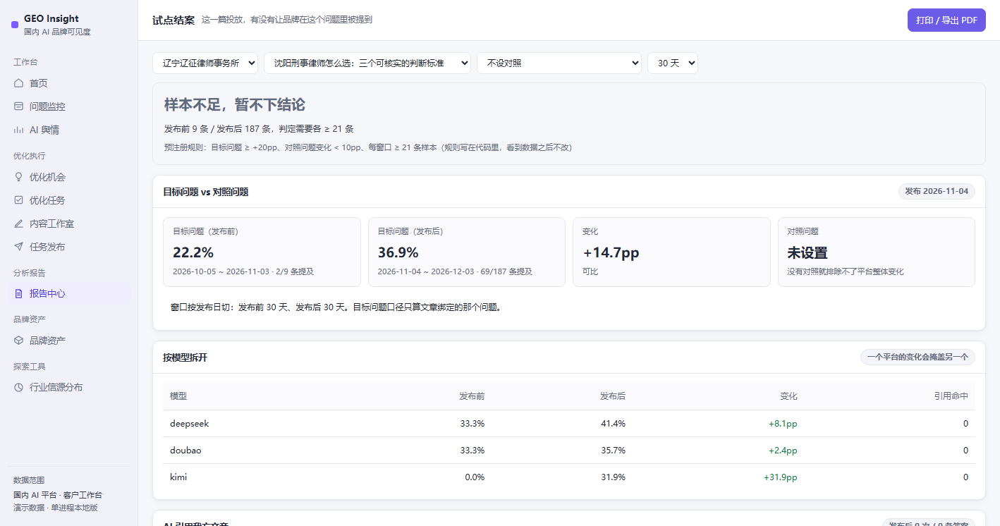
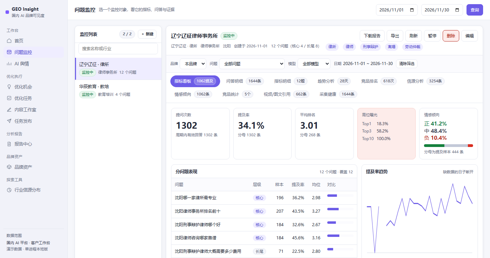
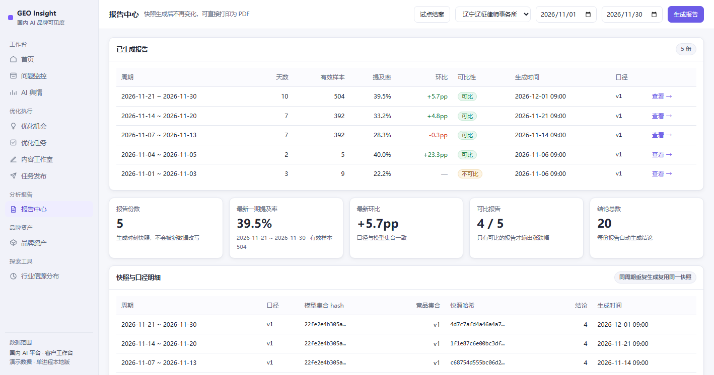
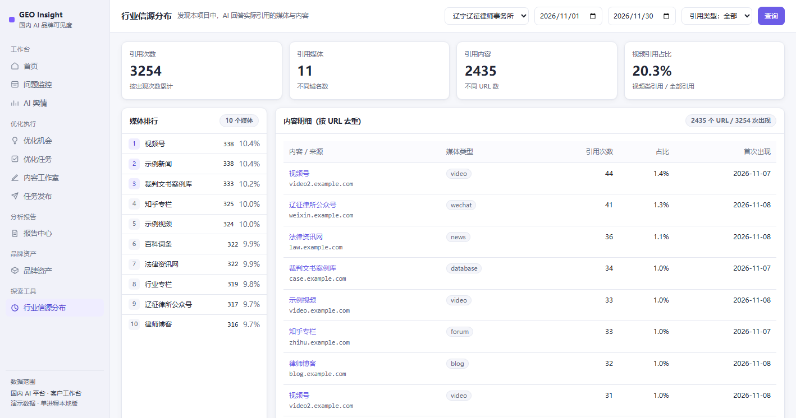

# GEO Insight 使用手册（小白版）

> 这本手册不假设你懂技术。
> 从头到尾用大白话讲：**这是干嘛的、你打开先点哪、屏幕上那些数字是什么意思。**
> 每个关键页面都配了真实截图，你对着看就行。
>
> 想知道技术细节的人请去看 `README.md` 和 `docs/roadmap.md`，那里才是给工程师看的。

---

## 一、先用一句话说清这系统是干嘛的

想象一下：

> 有人想找律师，就打开 AI 问："沈阳哪家律所比较专业？"
> AI 回答了一长串，里面**提到了你的律所**，或者**只提到了你的竞争对手**。
>
> 这个系统就是帮你盯着这件事：**AI 到底有没有提到你、提到了排第几、说你好话还是坏话、
> 它引用的文章是从哪儿抄来的。**

再进一步：如果发现"竞品总被提到、你从来不出现"，系统会告诉你**下一篇该写什么题目**，
你写完发出去，它还能帮你判断**这一篇到底有没有让情况变好**。

所以它的完整作用是三步：

```
   ① 盯着看  →  ② 找问题  →  ③ 试着改，再看有没有变好
  （AI 提没提我）  （哪题该写文章）   （发了文章前后对比）
```

**它不是这些**（先帮你排除误会）：

- ❌ 不是查百度/谷歌排名的（传统 SEO），只管 AI 的回答
- ❌ 不是"保证让你上 AI 推荐"的魔法，只帮你把情况量出来、试着改善
- ❌ 现在还不是给很多人同时用的系统，就是你们内部一两个人用
- ❌ 现在还没有真正去问 AI 的"钥匙"（API key），所以**目前屏幕上的是演示数据**，看流程和方法用

---

## 二、打开系统，第一眼该看哪

双击 `start.bat`，浏览器会打开一个登录页，账号已经填好，密码是 `geo-demo-2026`。登录进去就是首页。



*↑ 这就是首页。你不用一次看懂全部，我下面挑三个最要紧的地方给你讲。*

### 看第一个地方：顶部这一行

回到上面那张图，页面上能看到"2026/11/01 ~ 2026/11/30"和一个"查询"按钮——这是你在选**看哪段时间**。
右边还有"口径说明"，翻译过来就是"**这些数字是怎么算出来的**"，第一次用建议点开扫一眼。

### 看第二个地方：中间那排大方块

那 8 个方块是最要紧的，逐个用大白话解释：

| 屏幕上的词 | 大白话意思 |
|---|---|
| 提及数 **444** | 这段时间里，AI 的回答提到你 444 次 |
| 提及率 **34.1%** | 简单说：AI 回答里，大约每 3 次有 1 次提到你 |
| 覆盖率 **100%** | 你关心的那些问题里，每个问题至少有一次被提到 |
| 平均排名 **3.01** | AI 列名单时，你平均排第 3 位 |
| Top1 **18.3%** | 有名单时，18.3% 的情况你排第一 |
| Top3 **58.2%** | 有名单时，一半多的情况你进前三 |
| Top10 **100%** | 有名单时，你每次都进了前十 |
| 情感倾向 正 41.2% / 中 48.4% / 负 10.4% | 提到你时，夸你的 / 中性的 / 说你坏话的各占多少 |

> **看见"样本不足"四个字怎么办？**
> 那是系统在说"问得太少，不算数"。比如只问了两三次，它不会给你一个百分比糊弄你。
> 这是好事——总比拿 1 条数据说"100% 提到你"靠谱。

### 看第三个地方：点一下那些方块

**这些方块都能点**。点一下会滑出一个小窗口，列出"这个数字是由哪些回答算出来的"。
再点里面的"原文 →"，就能看到 AI 当时到底说了什么。

这就是这系统最实在的地方：**每个数字你都能追到原始答案，不是凭空变出来的。**

---

## 三、记住一条路线，你就不会迷路

左边的菜单分了 5 组，看着多，其实就是按做事顺序排的：

```
   工作台           优化执行            分析报告        品牌资产      探索工具
 ┌────────┐    ┌──────────────┐    ┌────────┐
 │ 首页    │ →  │ 优化机会（选题）│ →  │ 报告中心│
 │ 问题监控│    │ 内容工作室（写）│    │ →试点结案│
 │ AI舆情  │    │ 任务发布（看结果）│    └────────┘
 └────────┘    │ 优化任务（进度）│
               └──────────────┘
```

**你平时就照这个顺序用：**

> 首页看大概 → 问题监控查细节 → 优化机会挑题 → 工作室写文章发出去 →
> 看看发出去没 → 最后看这一篇到底有没有用。

下面我用"**假如你是辽宁辽征律所的市场负责人**"这个例子，带你把整条路走一遍。

---

## 四、手把手走一遍（照着点就行）

### 第 1 步：先告诉系统你要盯谁

进入左边菜单的 **问题监控**，左栏有个 **＋ 新建**，点它，右边会滑出一个小窗口。
要填的东西从左到右、从上到下是这样的：

- **官网地址**：选填，填上 https:// 开头的官网
- **监控名称**：随便起个好认的，比如"辽征-离婚业务"
- **品牌名称**：你的品牌全名，比如"辽宁辽征律师事务所"
- **核心词**：AI 提到这些词才算"说到你"，比如"律师""律所"——**不填就判断不出跑题**
- **行业、地区**：选填
- **别名**：把你常见的简称都写上，比如"辽征""辽征律所"——**这个很重要，AI 经常用简称提你，不写就认不出来**
- **竞品**：把主要对手写进去
- **监控问题**：每行写一个你想问 AI 的问题，想让某个问题多问几次（每天 3 次），就在前面加个 `*`
- **采集渠道**：下面是系统支持的 AI 渠道清单。能用的已经帮你勾好了，写"未接入"的现在是灰的、不能勾——**这不是坏了，是那些渠道还没接进来**

填完点 **创建并继续**。

> 💡 好消息：现在**建对象的时候就能把问题和核心词一起填了**，不用像以前那样建完再跑去配置页导入。
> 不过刚建完你还是会发现没什么数据——**这是正常的**，系统要按你填的问题去问 AI、采到答案后才有数字。

### 第 2 步：告诉系统拿哪些问题去问 AI

> 如果第 1 步建对象时你已经把问题填进去了，**这步可以先跳过**。这里是教你以后怎么补问题、改问题。

从对象头顶上的 **编辑** 进去（这个页面叫"监控配置"，它故意没放在左边菜单里）：



你要做的是：在"批量导入问题"那个框里，**一行写一个问题**，比如：

```
沈阳离婚律师收费标准是多少
沈阳合同纠纷律师怎么找
```

想让某个问题多问几次（每天 3 次），就在前面加个 `*`：

```
*沈阳离婚律师收费标准是多少
```

点 **导入并去重**，系统就记住了。它会自动安排：标 `*` 的每天问 3 次，没标的每天问 1 次。

> 顺便把"品牌别名""竞品"也在这儿补一补，跟第 1 步一个道理。

### 第 3 步：数据是怎么来的（这段很关键）

**页面上没有"开始采集"这种按钮**，别找了。数据只有两个来源：

1. **现在你看到的**，是系统自带的演示数据（1510 条回答），专门用来让你看明白流程；
2. **真正的实时数据**，需要配平台的"钥匙"（API key）才能去问 AI，**目前还没配**。

在 **问题监控 → 采集健康** 这个标签页，能看到"该问多少次 / 实际问了多少 / 还差多少"。
下面还有一张 **采集任务** 表，列着系统每次真去问 AI 的记录：什么时候排的、成功还是失败、
一共要问几条、成了几条、失败几条。**没跑过就显示"本周期尚无采集任务"，不会瞎编一条给你看。**

> ⚠️ **特别提醒**：如果你以后真要发文章做试验，发之前一定要来这里看一眼"还差多少"。
> 因为发文章之前的历史窗口一旦过去就补不回来了——**基线样本不够，这篇以后就永远判不出效果**。

### 第 4 步：挑一篇值得写的文章

进入左边菜单 **优化机会**：



看中间那块"**先写哪一篇**"——系统已经帮你排好队了，分数最高的排最上面。
每条下面还写了理由，比如"提及率偏低、竞品出现在 26/69 条回答里"。

看中哪条，点它右边的 **写这篇 →**，系统会自动带你去工作室，还帮你把题目选好。

> 这个分数只是"**建议先写哪篇**"，不代表写了就一定有效。

### 第 5 步：写文章，发出去



进了 **内容工作室**：

1. 如果你是从上一步"写这篇 →"过来的，新建文章的框已经打开、题目也选好了；
   否则点右上 **＋ 新建文章** 自己填。
2. 中间是"正文编辑"，左边是"创作要求"（告诉你这篇要解决什么问题），
   右边是"事实与证据"（你写的每句话最好都能找到依据，点 **核对事实清单** 帮你检查）。
3. 上面一行有 **6 个阶段**：信息研究 → 事实与证据 → 正文编辑 → 质量审核 → 类草稿 → 发布。
   做完一步点"完成本阶段 →"，刷新页面也不会丢。
4. 最下面"发布通道"：想发到知乎/公众号，先点 **连接**（手机扫码登录），再点 **检测**，
   勾上渠道后点 **一键发布到已选渠道**。发布要几分钟，可以等等再刷新看状态。

> 系统里的"积分"你不用管：那是内部记的账，显示每次调用有个成本，不是要你付钱。

### 第 6 步：看看发出去没有、效果怎样

两个页面分工不同，别搞混：

- **任务发布**：看"发出去了吗"。里面有发布记录、成功/失败原因、原文链接，还有发布前后的数字对比。
- **优化任务**：看"文章写到哪一步了"。草稿 / 待审 / 已发布三列看板。

### 第 7 步：最后判断——这篇到底有没有用

进 **报告中心**，点 **试点结案**：



你要选三样东西：哪个品牌、哪篇文章、拿哪个问题做"对照"。

**为什么要选对照问题？** 打个比方：

> 你发了篇讲"离婚律师收费"的文章，之后这个话题被提到的次数变多了。
> 但万一那阵子整个平台都在聊离婚呢？
> 所以再挑一个你没写过的"合同纠纷"问题当尺子——
> **如果只有你写的那个问题变好、对照的没动，才算你的文章真起了作用。**

系统会把这个"净变化"算好，直接给你一句结论：有效 / 没变化 / 证据不够 / 样本太少先别下结论。
右上角 **打印 / 导出 PDF** 可以把这页留档给客户看。

> 判断标准是提前定死的：目标问题至少提升 20 个百分点、对照问题变化不超过 10 个百分点、
> 前后两个阶段的样本都至少 21 条。**看到数据之后不许改标准**——这样结论才有说服力。

---

## 五、其他页面顺手讲一下

这些页面你不一定天天用，但需要的时候知道去哪找。

### 问题监控 — 查细节的地方



左边是监控对象列表，中间有 10 个标签页（指标看板、问答明细、趋势分析、竞品排名、信源分析、采集健康等等）。
哪个数字看不懂，就点进对应标签页翻原始回答。上面的按钮：

| 按钮 | 作用 |
|---|---|
| 下载报告 | 把当前这段时间的结论存成一份报告 |
| 表格浏览 | 一下跳到"问答明细"的表格样子，方便一行行翻原始回答 |
| 导出 | 把原始回答下载成表格文件 |
| 刷新 | 重新加载 |
| 暂停 / 恢复 | 暂时别采这个品牌的数据 |
| 删除 | **要你手打一遍品牌名才让删**，防误删 |
| 编辑 | 去改问题、别名、竞品等配置 |

### AI 舆情 — 不同 AI 比一比

同样的问题，豆包、DeepSeek、Kimi 回答得一样吗？这页把几个 AI 并排放，看谁更常提到你。

### 报告中心 — 出正式报告



点 **生成报告**，选好时间段，系统会冻结一份当时的数据快照（以后数据变了也不影响这份报告）。
打开报告详情，浏览器打印就是 PDF。

> 如果这一期跟上一期的口径或模型不一样，系统会写"**不可比**"，并且**不给涨跌幅**——
> 这是故意的，免得你拿着两个对不上的数字去汇报。

### 行业信源分布 — AI 都引用谁的文章



看 AI 的回答都引用了哪些网站、哪些文章。你想让自己的文章被 AI 引用，就来这里研究"AI 爱引谁"。
发布时间不知道的就标"未知"，系统不会瞎猜。

### 品牌资产 — 核对你配了啥

只读页面，看看品牌名、别名、竞品、问题数配得对不对。要改就去"监控配置"。

---

## 六、小白常见疑问

**Q：我第一次进来，为什么平均排名写着"样本不足"？**
A：因为有排名信息的回答太少了（不到 3 条）。系统在说"样本太少，不算数"，不是坏了。

**Q：我改了东西，页面看着没变化？**
A：先按 `Ctrl + Shift + R` 强制刷新。还不行，就可能你打开的是旧服务——
   关掉那个黑窗口，重新双击 `start.bat`。

**Q：这些数字是真的吗？**
A：现在屏幕上的是**演示数据**，用来学流程和看口径。真正盯着 AI 实时采样，需要配 API key，目前还没配。

**Q：我能导出数据吗？**
A：能。首页"导出 CSV"、问题监控的"导出"、配置页的"下载 CSV/JSONL"，导出的都是当前筛选条件下的真实内容。

**Q：积分要钱吗？**
A：不要。那是系统内部记的一笔账，显示"每次调用有个成本"，界面数字只是演示，没有付款入口。

**Q：我发了文章，怎么知道有没有用？**
A：走第 7 步"试点结案"。**但发之前先看采集健康页的样本够不够**——不够的话发完也判不出来，这个窗口期错过了就补不回来。

---

## 七、几个词，听不懂时回来查

正文我尽量说人话了，但跟别人讨论时可能会听到这些词，放这儿对照：

| 别人说的词 | 其实就是 |
|---|---|
| 监控对象 / tracker | 你要盯的那个品牌 |
| 问题集 | 你让系统去问 AI 的那堆问题 |
| 核心问题 / 长尾问题 | 重要问题（每天问 3 次）/ 一般问题（每天问 1 次） |
| 提及 | AI 回答里提到了你 |
| 提及率 | 提到你的次数占总回答的比例 |
| 样本 | 系统记录下来的每一次 AI 回答 |
| 分母 / 样本基数 | 算比例时"一共拿多少次回答来算" |
| 引用 / citation | AI 回答里附的网页来源链接 |
| 机会分 | 系统建议"先写哪篇"的排序分数 |
| 快照 | 生成报告那一刻被冻住的数据，以后不变 |
| 对照问题 | 你没写文章的那个问题，用来排除"整个平台都在变" |
| DiD / 净变化 | 你写文章那个问题的变化，减去对照问题的变化 |
| 口径 | 数字到底怎么算的规矩 |

---

## 八、我还想深入了解

| 你想知道 | 看哪份文档 |
|---|---|
| 这系统整个是怎么规划的、做到哪一步了 | `docs/roadmap.md` |
| 怎么启动、怎么排错、怎么验证 | 根目录 `README.md` |
| 试点效果到底怎么判、规则为什么这么定 | `docs/pilot-protocol.md` |
| 为什么要"多次采样""围绕问题做"这些设计 | `docs/GEO-Insight-整体方案.md` |
