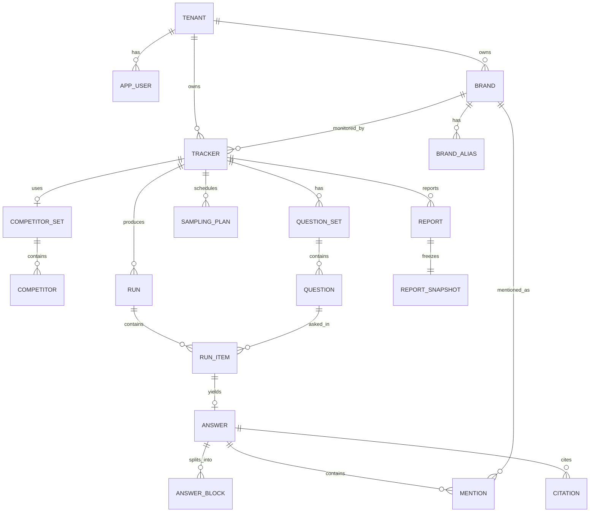

# 数据模型：GEO Insight 首版

**Feature**: `001-geo-insight-platform`
**Date**: 2026-11-11
**依据**: `spec.md` FR-001~035、`docs/decisions/001-clarifications.md`

存储分工：PostgreSQL 存配置与业务事实，ClickHouse 存答案/引用明细与指标宽表。两库通过 `answer_id` / `tracker_id` 关联，不做跨库事务。

---

## 1. 实体关系



---

## 2. PostgreSQL 实体

### 2.1 tenant

| 字段 | 类型 | 约束 | 说明 |
|---|---|---|---|
| id | uuid | PK | 租户标识 |
| name | varchar(120) | NOT NULL | 组织名称 |
| slug | varchar(60) | UNIQUE, NOT NULL | 短标识 |
| plan | varchar(20) | NOT NULL, default `internal` | 首版固定 internal，不开放计费 |
| status | varchar(20) | NOT NULL, default `active` | active / suspended |
| created_at | timestamptz | NOT NULL | |

### 2.2 app_user

| 字段 | 类型 | 约束 | 说明 |
|---|---|---|---|
| id | uuid | PK | |
| tenant_id | uuid | FK → tenant, NOT NULL | |
| email | varchar(200) | NOT NULL | |
| display_name | varchar(80) | NOT NULL | |
| role | varchar(20) | NOT NULL | admin / operator / viewer（FR-032） |
| status | varchar(20) | NOT NULL, default `active` | |
| created_at | timestamptz | NOT NULL | |

**唯一约束**：`UNIQUE (tenant_id, email)`。

### 2.3 brand / brand_alias

| 表 | 字段 | 类型 | 约束 | 说明 |
|---|---|---|---|---|
| brand | id | uuid | PK | |
| brand | tenant_id | uuid | FK, NOT NULL | |
| brand | name | varchar(120) | NOT NULL | 品牌全称 |
| brand | industry | varchar(60) | | 行业 |
| brand | region | varchar(60) | | 地区 |
| brand | created_at | timestamptz | NOT NULL | |
| brand_alias | id | uuid | PK | |
| brand_alias | brand_id | uuid | FK, NOT NULL | |
| brand_alias | alias | varchar(120) | NOT NULL | 简称 / 英文名 / 常见错写 |
| brand_alias | alias_type | varchar(20) | NOT NULL | full / short / en / misspell |
| brand_alias | is_active | boolean | default true | |

**唯一约束**：`UNIQUE (brand_id, alias)`（FR-002）。

### 2.4 competitor_set / competitor

| 字段 | 类型 | 约束 | 说明 |
|---|---|---|---|
| competitor_set.id | uuid | PK | |
| competitor_set.tenant_id | uuid | FK, NOT NULL | |
| competitor_set.version | int | NOT NULL | 自增版本，变更即新版本（FR-003） |
| competitor_set.created_at | timestamptz | NOT NULL | |
| competitor.id | uuid | PK | |
| competitor.competitor_set_id | uuid | FK, NOT NULL | |
| competitor.name | varchar(120) | NOT NULL | |
| competitor.aliases | jsonb | default `[]` | 别名数组 |

### 2.5 tracker

| 字段 | 类型 | 约束 | 说明 |
|---|---|---|---|
| id | uuid | PK | |
| tenant_id | uuid | FK, NOT NULL | |
| brand_id | uuid | FK → brand, NOT NULL | |
| competitor_set_id | uuid | FK, NULL | 未设置时不做竞品标注 |
| name | varchar(160) | NOT NULL | 展示名，如「辽宁辽征 · 律所」 |
| industry | varchar(60) | | |
| region | varchar(60) | | |
| status | varchar(20) | NOT NULL, default `draft` | draft / active / paused / archived（FR-001、FR-035） |
| owner_id | uuid | FK → app_user | |
| settings | jsonb | default `{}` | 时区、默认周期等 |
| created_at / updated_at | timestamptz | NOT NULL | |

**索引**：`(tenant_id, status)`。

### 2.6 question_set / question

| 字段 | 类型 | 约束 | 说明 |
|---|---|---|---|
| question_set.id | uuid | PK | |
| question_set.tenant_id | uuid | FK, NOT NULL | |
| question_set.tracker_id | uuid | FK → tracker, NOT NULL | |
| question_set.name | varchar(120) | NOT NULL | |
| question.id | uuid | PK | |
| question.question_set_id | uuid | FK, NOT NULL | |
| question.text | text | NOT NULL | 原问题 |
| question.normalized_text | text | NOT NULL | 去空白/标点/全半角后的文本，用于查重 |
| question.tier | varchar(20) | NOT NULL, default `long_tail` | core / long_tail（FR-004） |
| question.intent | varchar(60) | | 选填，如「推荐」「价格」「对比」 |
| question.status | varchar(20) | NOT NULL, default `active` | active / disabled |
| question.created_at | timestamptz | NOT NULL | |

**唯一约束**：`UNIQUE (question_set_id, normalized_text)`（FR-005）。
**索引**：`(question_set_id, tier, status)`。

### 2.7 sampling_plan

| 字段 | 类型 | 约束 | 说明 |
|---|---|---|---|
| id | uuid | PK | |
| tracker_id | uuid | FK, NOT NULL | |
| channel | varchar(10) | NOT NULL | api / web；首版仅记录，不执行 |
| model_keys | text[] | NOT NULL | 如 `{doubao, deepseek, kimi}` |
| core_times | smallint | NOT NULL, default 3 | FR-008 |
| long_tail_times | smallint | NOT NULL, default 1 | FR-008 |
| timezone | varchar(40) | NOT NULL, default `Asia/Shanghai` | |
| effective_from | date | NOT NULL | 变更次日生效（FR-012） |

### 2.8 run / run_item

| 字段 | 类型 | 约束 | 说明 |
|---|---|---|---|
| run.id | uuid | PK | |
| run.tenant_id | uuid | FK, NOT NULL | |
| run.tracker_id | uuid | FK, NOT NULL | |
| run.trigger | varchar(20) | NOT NULL | schedule / manual / backfill（FR-011） |
| run.status | varchar(20) | NOT NULL, default `queued` | queued / running / completed / partial / failed |
| run.scheduled_for | timestamptz | NOT NULL | |
| run.started_at / finished_at | timestamptz | | |
| run.stats | jsonb | default `{}` | `{planned, succeeded, failed, skipped}` |
| run_item.id | uuid | PK | |
| run_item.run_id | uuid | FK, NOT NULL | |
| run_item.question_id | uuid | FK, NOT NULL | |
| run_item.model_key | varchar(40) | NOT NULL | |
| run_item.channel | varchar(10) | NOT NULL | api / web |
| run_item.sample_idx | smallint | NOT NULL | 1..3（FR-009） |
| run_item.status | varchar(20) | NOT NULL, default `queued` | queued / running / succeeded / failed / skipped |
| run_item.error_code | varchar(40) | | TIMEOUT / RATE_LIMITED / REFUSED / EMPTY / OTHER（FR-010） |
| run_item.attempted_at | timestamptz | | |

**唯一约束**：`UNIQUE (run_id, question_id, model_key, channel, sample_idx)`（幂等，FR-009）。
**索引**：`(run_id, status)`、`(status, attempted_at)`。

### 2.9 answer / answer_block

| 字段 | 类型 | 约束 | 说明 |
|---|---|---|---|
| answer.id | uuid | PK | |
| answer.run_item_id | uuid | UNIQUE, FK | 一条采样最多一条答案 |
| answer.tenant_id / tracker_id / question_id | uuid | NOT NULL | 冗余，便于按对象查询 |
| answer.model_key | varchar(40) | NOT NULL | |
| answer.model_version | varchar(80) | | 模型标识或网页端版本（可空） |
| answer.channel | varchar(10) | NOT NULL | |
| answer.raw_uri | text | NOT NULL | 原始响应在对象存储的地址 |
| answer.text | text | NOT NULL | 解析后的纯文本答案 |
| answer.text_hash | char(64) | NOT NULL | 去重与变化检测 |
| answer.collected_at | timestamptz | NOT NULL | |
| answer.latency_ms | int | | |
| answer.token_in / token_out | int | | 仅 API 通道 |
| answer.cost | numeric(10,4) | | 仅 API 通道 |
| answer.is_valid | boolean | NOT NULL, default true | 空答案/拒答为 false（FR-010） |
| answer.invalid_reason | varchar(40) | | |
| answer_block.id | uuid | PK | |
| answer_block.answer_id | uuid | FK, NOT NULL | |
| answer_block.seq | smallint | NOT NULL | 从 1 开始 |
| answer_block.block_type | varchar(20) | NOT NULL | paragraph / list_item / table_row |
| answer_block.text | text | NOT NULL | |
| answer_block.list_index | smallint | NULL | 仅 list_item，列表内序号（FR-014） |

**索引**：`(tenant_id, tracker_id, collected_at desc)`、`(question_id, model_key, collected_at desc)`。

### 2.10 mention

| 字段 | 类型 | 约束 | 说明 |
|---|---|---|---|
| id | uuid | PK | |
| answer_id | uuid | FK, NOT NULL | |
| brand_id | uuid | FK → brand, NOT NULL | 竞品提及也写本表，用 `subject_type` 区分 |
| subject_type | varchar(10) | NOT NULL, default `own` | own / competitor（FR-003） |
| matched_alias | varchar(120) | NOT NULL | 命中的别名 |
| match_type | varchar(20) | NOT NULL | exact / normalized / fuzzy |
| position | smallint | NULL | 位次，无列表为 NULL（FR-014） |
| position_type | varchar(20) | NULL | 首版固定 `list_index` |
| sentiment | varchar(10) | NOT NULL | pos / neu / neg（FR-017） |
| sentiment_confidence | numeric(3,2) | | 0.00~1.00 |
| snippet | text | NOT NULL | 品牌相关片段 |

**唯一约束**：`UNIQUE (answer_id, brand_id)` —— 同一答案同一品牌只计 1 次提及（FR-020）。
**索引**：`(brand_id, sentiment)`、`(answer_id)`。

### 2.11 citation

| 字段 | 类型 | 约束 | 说明 |
|---|---|---|---|
| id | uuid | PK | |
| answer_id | uuid | FK, NOT NULL | |
| url | text | NOT NULL | |
| url_hash | char(64) | NOT NULL | 用于去重统计 |
| domain | varchar(200) | NOT NULL | 归一化域名 |
| media_name | varchar(200) | | 媒体名，如「百家号」 |
| media_type | varchar(30) | | news / video / encyclopedia / ecommerce / social / qa / doc / gov / forum / official / other（FR-025） |
| position | smallint | NOT NULL | 在答案引用列表中的位置 |
| cite_type | varchar(20) | NOT NULL | inline / reference / video（FR-025） |
| published_at | timestamptz | NULL | |
| published_at_unknown | boolean | NOT NULL, default false | 时间识别不出时为 true（FR-026） |

**不设唯一约束**：同一 URL 在一条答案中可出现多次，引用次数按行累计（FR-020）；内容明细按 `url_hash` 去重展示。
**索引**：`(answer_id)`、`(domain, published_at)`。

### 2.12 report / report_snapshot

| 字段 | 类型 | 约束 | 说明 |
|---|---|---|---|
| report.id | uuid | PK | |
| report.tenant_id / tracker_id | uuid | NOT NULL | |
| report.period_start / period_end | date | NOT NULL | 校验 `period_start < period_end` |
| report.status | varchar(20) | NOT NULL, default `queued` | queued / generating / ready / failed（FR-027） |
| report.metric_version | varchar(20) | NOT NULL | 口径版本 |
| report.model_set_hash | char(16) | NOT NULL | 模型集合指纹，用于判「不可比」（FR-029） |
| report.competitor_set_version | int | NULL | |
| report.created_by | uuid | FK → app_user | |
| report.created_at / ready_at | timestamptz | | |
| report_snapshot.report_id | uuid | PK, FK | 1:1 |
| report_snapshot.payload | jsonb | NOT NULL | 指标、图表、结论、样本量（FR-028） |
| report_snapshot.payload_hash | char(64) | NOT NULL | 防篡改校验 |
| report_snapshot.generated_at | timestamptz | NOT NULL | |

### 2.13 audit_log

| 字段 | 类型 | 约束 | 说明 |
|---|---|---|---|
| id | bigserial | PK | |
| tenant_id | uuid | NOT NULL | |
| actor_id | uuid | | |
| action | varchar(60) | NOT NULL | create / update / delete / export / run |
| object_type | varchar(40) | NOT NULL | tracker / question / report … |
| object_id | uuid | | |
| before / after | jsonb | | 变更前后快照 |
| created_at | timestamptz | NOT NULL, default now() | |

**索引**：`(tenant_id, created_at desc)`、`(object_type, object_id)`。

---

## 3. ClickHouse 宽表

### 3.1 metric_daily

| 字段 | 类型 | 说明 |
|---|---|---|
| tenant_id | UUID | |
| tracker_id | UUID | |
| question_id | UUID | |
| model_key | LowCardinality(String) | |
| channel | LowCardinality(String) | api / web |
| date | Date | |
| metric_version | LowCardinality(String) | 口径版本（FR-019） |
| sample_total | UInt32 | 全部采样记录 |
| valid_total | UInt32 | 有效样本（分母） |
| mention_total | UInt32 | 提及样本数 |
| ranked_total | UInt32 | 位次非空的样本数（FR-015） |
| top1 / top3 / top10 | UInt32 | 位次 ≤ N 的样本数 |
| sentiment_pos / neu / neg | UInt32 | 只在提及样本内统计（FR-017） |
| covered_questions | UInt32 | 当日有问题被提及的计数，用于覆盖率 |
| updated_at | DateTime | |

**引擎**：`ReplacingMergeTree(updated_at)`，`PARTITION BY toYYYYMM(date)`，`ORDER BY (tenant_id, tracker_id, date, question_id, model_key, channel, metric_version)`。

### 3.2 answer_fact

| 字段 | 类型 | 说明 |
|---|---|---|
| tenant_id / tracker_id | UUID | |
| answer_id | UUID | 幂等键 |
| question_id | UUID | |
| model_key / channel | LowCardinality(String) | |
| collected_at | DateTime | |
| text | String | 明细下钻展示 |
| raw_uri | String | 对象存储地址 |
| is_valid | UInt8 | |
| mention_count | UInt16 | |
| citation_count | UInt16 | |

**引擎**：`MergeTree`，`PARTITION BY toYYYYMM(collected_at)`，`ORDER BY (tenant_id, tracker_id, collected_at, answer_id)`。

### 3.3 citation_fact

| 字段 | 类型 | 说明 |
|---|---|---|
| tenant_id / tracker_id | UUID | |
| answer_id | UUID | |
| url | String | |
| url_hash | String | |
| domain | String | |
| media_name | String | |
| media_type | LowCardinality(String) | |
| published_at | Nullable(DateTime) | |
| published_at_unknown | UInt8 | |
| cite_type | LowCardinality(String) | |

**引擎**：`MergeTree`，`PARTITION BY toYYYYMM(published_at)` 不可靠（大量 NULL），改为按写入月分区：加 `ingested_at Date` 字段后 `PARTITION BY toYYYYMM(ingested_at)`，`ORDER BY (tenant_id, tracker_id, domain, answer_id)`。

---

## 4. 状态机

### tracker

```text
draft ──激活──> active ──暂停──> paused ──恢复──> active
                    │                 │
                    └──归档───────────┴──> archived
```

- `archived` 不可回到 `active`，需要新建监控对象（FR-035）。
- 进入 `archived` 前必须先 `paused`，历史数据保留。

### run

```text
queued ──开始──> running ──全部成功──> completed
                    ├──部分失败──> partial
                    └──全部失败──> failed
```

### run_item

```text
queued ──执行──> running ──成功──> succeeded
                    ├──失败且可重试──> queued（最多 2 次）
                    ├──失败且不可重试──> failed
                    └──跳过（问题停用）──> skipped
```

### report

```text
queued ──生成──> generating ──成功──> ready
                         └──失败──> failed ──重试──> queued
```

---

## 5. 约束与口径映射

| FR | 数据落点 | 约束/公式 |
|---|---|---|
| FR-005 问题查重 | question.normalized_text | `UNIQUE (question_set_id, normalized_text)` |
| FR-009 采样可区分 | run_item.sample_idx | `UNIQUE (run_id, question_id, model_key, channel, sample_idx)` |
| FR-014 位次 | mention.position / position_type | `position IS NULL OR position >= 1` |
| FR-015 平均排名分母 | metric_daily.ranked_total | 只统计 `position IS NOT NULL` 的样本 |
| FR-016 提及率 | mention_total / valid_total | 分母为有效样本 |
| FR-016 覆盖率 | covered_questions / active_questions | 分母为 `question.status = active` 的问题数 |
| FR-017 情感 | sentiment_pos/neu/neg | 分母为 `mention_total`，未提及不进分母 |
| FR-018 样本不足 | valid_total / ranked_total | 任一 < 3 时对应指标返回 `insufficient_samples` |
| FR-020 提及计 1 次 | mention 唯一键 | `UNIQUE (answer_id, brand_id)` |
| FR-020 引用累计 | citation 行数 | 不去重；明细按 `url_hash` 去重 |
| FR-028 报告不可变 | report_snapshot.payload | 生成后只读，`payload_hash` 校验 |
| FR-029 不可比 | report.model_set_hash | 与对比周期不一致时置 `comparable = false` |

---

## 6. 索引与分区清单

**PostgreSQL**

- `tracker (tenant_id, status)`
- `question (question_set_id, tier, status)`
- `run (tracker_id, scheduled_for desc)`
- `run_item (run_id, status)`
- `answer (tenant_id, tracker_id, collected_at desc)`
- `mention (answer_id)`, `mention (brand_id, sentiment)`
- `citation (answer_id)`, `citation (domain, published_at)`
- `report (tracker_id, period_end desc)`
- `audit_log (tenant_id, created_at desc)`

**ClickHouse**

- `metric_daily`: `PARTITION BY toYYYYMM(date)`，`ORDER BY (tenant_id, tracker_id, date, question_id, model_key, channel)`，`ReplacingMergeTree(updated_at)`
- `answer_fact`: `PARTITION BY toYYYYMM(collected_at)`，`ORDER BY (tenant_id, tracker_id, collected_at, answer_id)`
- `citation_fact`: `PARTITION BY toYYYYMM(ingested_at)`，`ORDER BY (tenant_id, tracker_id, domain, answer_id)`

**TTL**

- `answer_fact` / `citation_fact` 保留 180 天后归档到对象存储（FR-034）。
- `audit_log` 保留 365 天。
